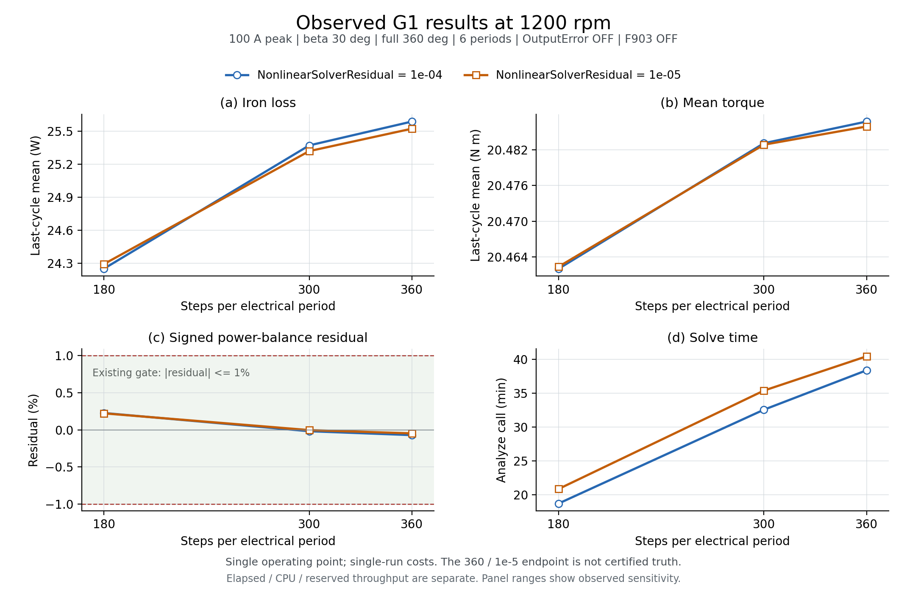

# G1 단일 운전점: 시간 분할·비선형 잔차 실제 비교

6개 결과가 기존 수치 진단 게이트를 통과했습니다. 철손 변화는 180→300 steps/period에서 **4.23–4.62%**, 300→360에서 **0.80–0.85%**였습니다. 후속 공간 메시 검증에는 300단계를 시간 이산화 후보로 둡니다. 생산 프로파일·회귀모델 승격은 보류합니다.

## 원래 문제

철손의 시간 분할 민감도와 해석 비용을 확인해야 했습니다. 이번 범위는 **단일 G1 형상·1200 rpm·I_peak 100 A·β 30°**입니다. full360/Symmetry1, 6주기, 동일 재료·권선·공간 메시 입력을 유지하고 OutputError와 F903은 OFF로 고정했습니다.

## 개선 아이디어와 실험

Steps/period 180·300·360 × NonlinearSolverResidual 1e-4·1e-5의 6점을 비교했습니다. 기존 100947을 기준점으로 재사용했고 새 5건은 완료됐습니다. 360/1e-5도 관측된 가장 세밀한 끝점이며 진실값이나 독립 정확도 기준으로 승인되지 않았습니다.

## 확인된 결과

| Task | Steps/period | 설정 잔차 | 철손 W | 평균 토크 N·m | 전력수지 잔차 % | Solve 분 |
|---:|---:|---:|---:|---:|---:|---:|
| 100947 | 180 | 1e-04 | 24.2493 | 20.46202 | +0.22746 | 18.70 |
| 100952 | 180 | 1e-05 | 24.2916 | 20.46236 | +0.22308 | 20.85 |
| 100953 | 300 | 1e-04 | 25.3702 | 20.48310 | -0.01767 | 32.58 |
| 100954 | 300 | 1e-05 | 25.3183 | 20.48285 | -0.00278 | 35.40 |
| 100955 | 360 | 1e-04 | 25.5869 | 20.48674 | -0.07010 | 38.41 |
| 100956 | 360 | 1e-05 | 25.5220 | 20.48591 | -0.04683 | 40.47 |

철손 변화율은 원본의 사전 지정 paired 비교 값을 사용했습니다. 300→360의 solve 시간 증가는 14.32–17.90%로 관측됐습니다. Solve 분은 `timings.solve_s / 60`으로, Analyze API 호출 구간입니다. 반복 실행·동일 시스템 부하에서의 비용 재현성은 아직 확인하지 않았습니다.

[독립 SVG](ACTUAL6_METRICS.svg) · [그래프 원수치 CSV](ACTUAL6_PLOT_DATA.csv)

## 판정과 증거 범위

- Native 종료·소유권 증거 known: **6/6**. 정상상태 gate: **6/6**. 10출력 유한값·raw 재현: **6/6**.
- 전력수지 `abs(residual) <= 1%`: **6/6**. 사전 지정 7쌍 × 10지표의 고정 민감도 한계: **70/70 통과**.
- Native known, 정상상태, paired 민감도 통과는 별도 조건으로 확인했습니다. 전체 설계·운전 영역이나 공간 메시 정확도를 인증하지 않습니다.
- 100947의 시간 설정은 유일한 저장 VariableProp와 실제 Time grid로 확인했습니다. 해당 기준점의 live SI 4변수 readback은 없습니다. 새 5점은 live SI 4변수·저장값·실제 grid 증거를 갖습니다.

고정한 10개 지표의 비교 한계는 다음과 같습니다. Ld/Lq와 전압 두 항목은 각자 별도 지표입니다. 효율 한계는 상대 %가 아닌 percentage point입니다.

| 지표 | 고정 한계 | 단위 |
|---|---:|---|
| 평균 토크 | 1 | 상대 % |
| 최대 토크 | 2 | 상대 % |
| 철손 | 5 | 상대 % |
| 고체 와전류 손실 | 5 | 상대 % |
| 총손실 | 3 | 상대 % |
| 효율 | 0.5 | %p |
| Ld / Lq | 2 | 각각 상대 % |
| 상전압 peak / 전압 span peak | 2 | 각각 상대 % |

## 남은 검증

300단계를 후속 **공간 메시 세분화 비교의 후보**로 사용해 독립적인 메시 민감도를 확인해야 합니다. 다른 형상·속도·전류·β에 대한 재현성, 독립 기준 대비 정확도, 반복 비용 검증이 남아 있습니다. 이 결과로 생산 profile이나 학습 모델을 승인하지 않습니다.

입력: `actual6_root_comparison.json` 514,679 bytes, SHA-256 `8d9b974ee5c87be4dda9f00c96e74389b3a0d99ad1fe617f65ab232c31411085`. 원본이 선언한 1,269개 입력의 크기·SHA를 보고서 작성 전후 검증했습니다. 원본 결과·오류·판정은 수정하지 않았습니다. 세부 해시는 `RAW_INPUT_SHA_BEFORE_AFTER.json`, 작성 검증은 `REPORT_PROOF.json`에 보관합니다.
