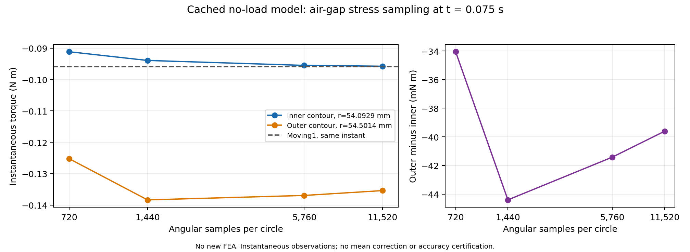

# 저장 자계의 독립 공극 응력 토크 비교

기존 두 토크 보고서가 같은 `Moving1.Torque`를 참조하므로 독립 검증이 아니었습니다. 같은 무부하 저장 해석158에서 B 벡터를 읽어 두 공극 원의 Maxwell 응력 토크를 별도로 계산했습니다. 추가 FEA는 없습니다. 이 자료는 Source1815의 기존 저장 모델이며, 현재 Source17의 부하·M1 설정 검증과 구분합니다.

## 문제 → 시도 → 수정 → 확인

- **문제:** 첫 독립 읽기의 `Unit=m` 점 파일은 요청한 위치의 정확히 0.001배 위치를 반환했습니다. 720개 좌표 모두 같았으며 공극 자계가 아니므로 값을 재배율해 복구하지 않았습니다.
- **수정:** SDK의 모델 단위 예시에 맞춰 입력점을 mm로 기록하고, 반환된 SI 좌표를 원래 목표 위치와 대조했습니다. 좌표 허용오차5e-10m는 출력 형식 확인용이며 물리 정확도 기준이 아닙니다. 출력 재배율·Smooth·대체 표현식은 사용하지 않았습니다.
- **확인:** 수정 읽기와 각도 세분화 읽기가 정상 종료했습니다. 각 소유 PID62544·42872의 종료, client 정리, 원본·캐시 불변, 기존8보고서 바이트 일치를 확인했습니다. 새 공개 모듈은 원시8파일의38,880개 위치와 토크를 재검사했고 기존 계산과 비트 단위로 일치했습니다. 순수 검사25개도 통과했습니다.
- **보존:** 첫 읽기의 실패와15초 종료 확인 실패는 유지합니다. 이후 별도 OS 관찰에서 PID62172 부재를 확인했습니다. 원래 해석158의 실패 및 학습 미승인 상태도 바꾸지 않았습니다.

## 관측된 수치와 범위

같은 `t=0.075s`, 실제 깊이0.0436181m를 한 번 적용하고 전체 Sym1을 사용했습니다. 두 반경은54.0929124470mm와54.5013718387mm이며, 그 사이 Band의 명목 반경은54.2971421428mm입니다. 시간은 명시적 API 요청 및 저장 Field199에 연결되며 별도 반환 시간 getter로 확인한 값은 아닙니다. B의 Tesla 단위는 문서화된 기본 B/MKS 계약에 근거합니다.

| 원당 각도 표본 수 | 안쪽 응력 토크 Nm | 바깥쪽 응력 토크 Nm | 바깥−안쪽 Nm |
|---:|---:|---:|---:|
| 720 | −0.09117290 | −0.12522629 | −0.03405340 |
| 1440 | −0.09394314 | −0.13835029 | −0.04440715 |
| 5760 | −0.09551745 | −0.13693566 | −0.04141821 |
| 11520 | −0.09577880 | −0.13538789 | −0.03960909 |

같은 시각의 `Moving1.Torque`는−0.09589354Nm입니다. 마지막 안쪽 값과의 차이는+0.00011474Nm, 바깥쪽과의 차이는−0.03949434Nm입니다. 5760→11520의 변화는 안쪽−0.00026135Nm·바깥쪽+0.00154778Nm였습니다. **표본 수를 늘려도 반경 차이가 관측되지만, 각도·공간 수렴이나 원인은 아직 확정하지 않습니다.**



[전체 정밀도 CSV](metrics.csv) · [공유용 SVG](angular_sampling.svg)

이 한 시점의 값을 주기 평균 토크나 약6.3W 평균 전력수지 잔차의 보정값으로 사용하지 않습니다. 기존 저장5시점은 같은 전기 위상입니다. 다음 판별은 Band 형상·회전 인터페이스·공간 메시의 영향을 통제한 비교입니다. 기존 모델의 Band는144개 변(NumEdges144·NumFaces0)이며 저장된 길이 제한 설정은0.5mm입니다. 실제 요소 변 길이의 최댓값을 측정한 결과는 아닙니다. 전체 최종 요소는112,138개입니다. 현재 Source17 M1은 다른 메시 설정이므로 직접적인 전후 비교로 사용하지 않습니다.

## 재사용 가능한 순수 코드

프로젝트 설치 환경에서 다음과 같이 검사할 수 있습니다. `.fld`와 별도의 반경·깊이·단위·요청 시각 근거가 필요합니다. 출력은 기존 파일을 덮어쓰지 않습니다.

```powershell
python -m pyaedt_motor.airgap_diagnostics --field path/to/B.fld --radius-m 0.05450137183865286 --depth-m 0.0436181 --field-unit T --requested-time-s 0.075 --output new_diagnostic.json
```

구현은 [airgap_diagnostics.py](../../../src/pyaedt_motor/airgap_diagnostics.py), 검사는 [test_ipmsm_airgap_diagnostics.py](../../../tests/test_ipmsm_airgap_diagnostics.py)에 있습니다. Native 의존성 없이 좌표·자료 형식·단위를 확인하고 순간 토크를 계산합니다. `complete_evidence`는 입력 자료 형식의 완전성만 뜻하며 정확도·학습 승인을 뜻하지 않습니다.

원본 근거: `R/e158airgap2`, `R/e158airgap_refine1`, `R/part76/PUBLIC_ACTUAL8_REPLAY.json`, `R/actual158_band_mesh_readonly_part76_20261101/BAND_MESH_REVIEW.json`. R은 `C:/Users/peets/NEC/pyaedt_motor_runtime/rebuild_20261030`입니다. [공식 점 파일 예시](https://ansyshelp.ansys.com/public/Views/Secured/Electronics/v252/en/Subsystems/Maxwell/Content/ReportsandPostProc/ExportCommand.htm), [Maxwell 응력 정의](https://ansyshelp.ansys.com/public/Views/Secured/Electronics/v252/en/Subsystems/Maxwell/Content/Maxwell/ForceDensityCalculationinMaxwell.htm).
