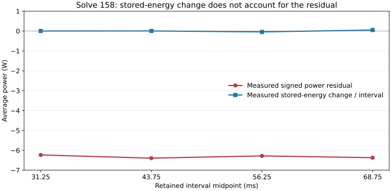

# 저장 자기 에너지와 전력수지 차이 비교

실제 해석158의 저장 결과를 재해석 없이 회수했습니다. **측정한 자기 에너지 변화로 약 −6.3 W의 전력수지 차이를 설명하지 못했습니다.** 원인은 아직 확정하지 않았으며 결과값이나 허용오차를 보정하지 않았습니다.

## 실제 수치

1200 rpm 무부하, 8극, 6전기주기, 주기당300단계의 고정 진단 모델입니다. 저장된5시점의 Energy·Coenergy와 같은 해석의8개 보고서를 비교했습니다.

| 구간 s | 기존 전력수지 차이 W | 측정 ΔU/Δt W |
|---|---:|---:|
| 0.025–0.0375 | −6.233512 | +0.004755 |
| 0.0375–0.0500 | −6.393391 | +0.008685 |
| 0.0500–0.0625 | −6.279655 | −0.040991 |
| 0.0625–0.0750 | −6.370955 | +0.054188 |

0.025→0.075 s의 전력수지 차이 적분은 **−0.315968893149 J**, 측정 ΔU는 **+0.000332951159 J**입니다. 부호와 크기가 다릅니다. [측정5시점](measured_points.csv)과 [구간별 전체 값](interval_balance.csv)에 반올림 전 수치를 보존했습니다. [PNG 그림](energy_balance.png)도 제공합니다.

## 계산과 검증 범위

- 전력수지 차이는 `Pin − Tω − CoreLoss − SolidLoss − Cu`입니다. 기존 시간 가중 적분 함수를 그대로 사용했습니다. 실제3상 전류가 모두0이므로 이 실행의 Pin과 Cu는0이며, 토크의 음수 부호를 유지합니다. `Tω`는 기계·인버터 손실을 포함한 순축출력 인증값이 아닙니다.
- 필드121회 호출 기록, 원시10개 scalar 파일, 같은 실행의1801표본 보고서8개를 대조했습니다. 실제 SI 깊이0.0436181 m, 모델 mm, 대칭계수1을 확인했으며 XY 기준1 m 적분값에는 깊이를 한 번만 곱했습니다. 기존 토크·손실 보고서는 재배율하지 않았습니다.
- t=0의 저장 에너지는 없습니다. 전체0→0.075 s의 ΔU나 전체 에너지 보존을 주장하지 않습니다. Coenergy를 저장 에너지 대신 사용하지 않았고 과거140의 에너지 변화도 재사용하지 않았습니다.
- 원래158은 캐시 파서 오류로 `failed_diagnostic`입니다. 회수r2도15초 종료 확인이 늦어 `failed_readback`이며, 이후 소유 PID 부재는 별도 Root 관찰로만 확인했습니다. 원래 실패는 유지합니다. 불완전한r1 JSON은 계산에 쓰지 않았습니다.
- 진단 수치 비교입니다. 학습·생산 프로파일·새 영점·전체 수렴을 승인한 결과는 아닙니다.

## 문제 → 수정 → 확인 → 다음 작업

기존 파서가 ID/시간 한 쌍만 가정해 실제5쌍의 저장 형식을 거부했습니다. 엄격한 다중 쌍 파서로 사본을 검증한 뒤 별도 읽기 전용 Native 세션에서 회수했습니다. 이어 무부하 효율의 미정의값 때문에 JSON 저장이 실패한 경로를 수정해, 미정의값을 명시하고 전체 읽기 기록을 먼저 저장하도록 했습니다. 과거 패킷과 실패 파일은 보존했습니다.

순수 평가12개 검사가 통과했고 입력973개를 전후 검증했습니다. 저장 에너지 변화 가설은 위 측정으로 설명력이 부족함을 확인했습니다. 다음은 같은 캐시의 고정자·회전자 손실 성분과 토크 정의를 대조하는 것입니다. 저장 파일에는 철손의 자계 반영이 켜져 있어 단순히 반영 누락이라고 판단할 수 없습니다. [Ansys 철손 설정 설명](https://ansyshelp.ansys.com/public/Views/Secured/Electronics/v251/en/Subsystems/Maxwell/Content/Maxwell/SettingCoreLossforTransientandEddyCurrentSolvers.htm)

원본 근거는 `C:/Users/peets/NEC/pyaedt_motor_runtime/rebuild_20261030/energy158_balance_assessment_20261101/`입니다. 평가 SHA256 `53fa1d8c68f0a459896f03a8fd5116e6aa6b0859bed8fb00d9f7e3b51d2f95b9`, 최종 봉인 `b8dd95a31c6d2102aed213366734a534b7edb32446d1c21b773c2699759d5886`. 보고서의 CSV는 봉인된 원본과 바이트가 같습니다.
