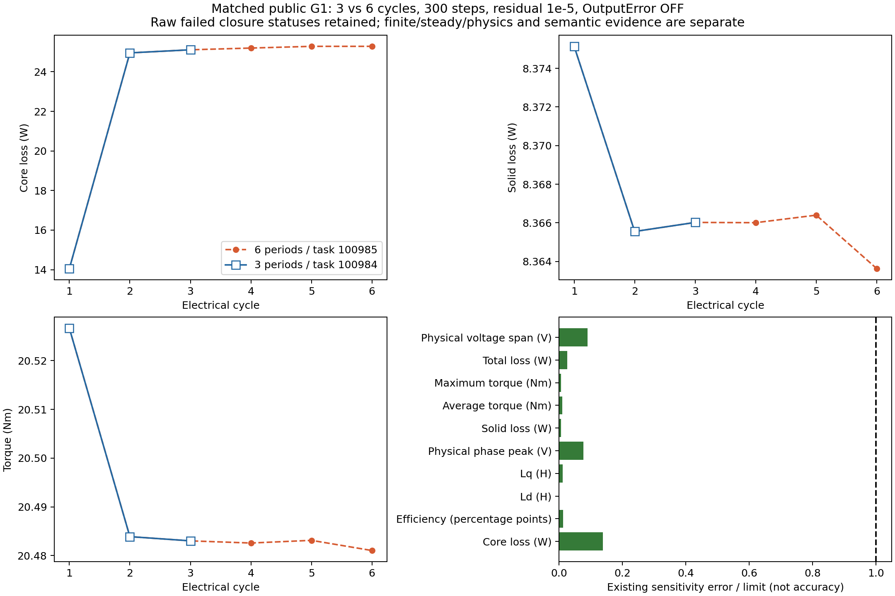
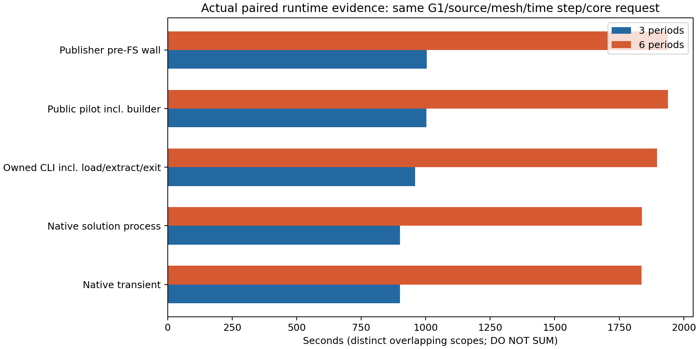

# 실제 공개 실행의 3·6주기 비교

동일한 G1 형상, 1200 rpm, 100 A peak, β30°, full360/Sym1, 주기당300단계, 비선형 잔차1e-5, OutputError OFF, 전체 겉보기 인덕턴스와 기본 COUNT 메시를 비교했습니다. 두 작업은 n113에서 각각4CPU를 사용했고, 실제 행렬901/1801개가 모두4코어였습니다. 전역 삼각형은 둘 다9,828개입니다.

기존 10개 민감도 허용기준과 정상상태·물리 검사를 모두 통과했습니다. 가장 큰 상대 변화는 철손0.690734%였고 평균 토크 변화는0.009697%였습니다. 6주기 값을 비교 기준으로 삼았으며 참값으로 간주하지 않습니다. 한 형상·운전점의 결과이고 공간 메시·다른 형상/속도/전류각·전 프로파일의 정확도를 인증하지 않습니다.

| 지표 | 3주기 | 6주기 | 단위 |
| --- | ---: | ---: | --- |
| 평균 토크 | 20.483028 | 20.481042 | Nm |
| 최대 토크 | 25.103541 | 25.100672 | Nm |
| 철손 | 25.110063 | 25.284713 | W |
| 자석 고체손실 | 8.3660222 | 8.3636322 | W |
| 총손실 | 225.81782 | 225.99008 | W |
| 추정 전자기 효율 | 91.934476 | 91.928101 | % |
| Ld | 0.00067518244 | 0.00067518477 | H |
| Lq | 0.00066508398 | 0.00066524612 | H |
| 상전압 최대값 | 27.146165 | 27.187899 | V |
| 전압 span | 48.3849 | 48.297925 | V |

| 시간 범위 | 3주기 | 6주기 | 단위 |
| --- | ---: | ---: | --- |
| Native transient | 900.000 | 1836.000 | s |
| 빌드 포함 전체 pilot | 1003.177 | 1938.401 | s |

전체 pilot 시간은 **48.25% 감소**했습니다. 표의 시간 범위는 겹치므로 합산하지 않습니다. 반복 측정이나 코어 수별 성능 비교는 아닙니다.

코드224fafd, 물리 생산자307b, 실제 작업100984/100985입니다. 두 원래 작업은 저장 전후 상태 동등성이 미검증되어 `failed`/`solved_saved_closure_unproven`을 유지합니다. 수치·프로세스 검증과 저장 상태·학습 승인은 별도입니다. 다음은 영역별 공간 수렴과 다른 형상·속도 검증, 보존한 미해석 원본을 이용한 실제 backend/frame/profile 연결입니다.

[간추린 수치·범위](SUMMARY.json), [SVG 출력 비교](accuracy_evidence.svg), [SVG 실행 시간](runtime_scopes.svg). 원시9CSV·프로파일·전체 봉인은 `R/pd14/actual_100984`, `R/pd14/actual_100985`, 독립 검토는 `R/public_p36_comparison_20261101`에 보관합니다. R은 프로젝트 HANDOFF의 로컬 실행 루트입니다.
