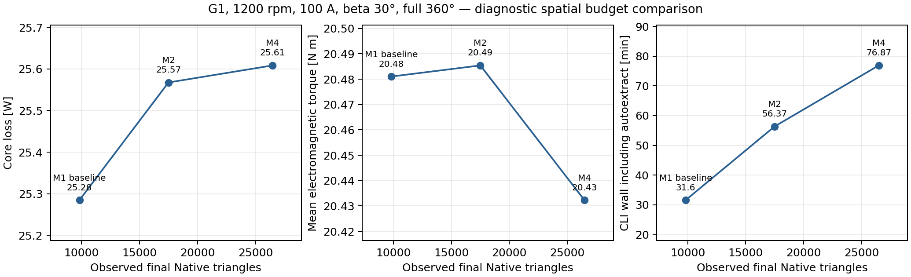

# 실제 공간 메시 비교: G1, 1200 rpm

## 문제와 시도

메시를 늘렸을 때 출력이 얼마나 달라지고 시간이 얼마나 증가하는지 확인했습니다. 같은 M19 기준 형상·1200 rpm·100 A peak·β30°·전체 360°·6주기·주기당 300단계·4코어 조건에서 다섯 COUNT 메시 제어값만 기본/M2/M4로 비교했습니다. M2/M4는 제어값의 2배/4배이며 실제 요소 수의 배율이 아닙니다. 물리 생성기는 세 경우 모두 `producer_v3:sha256:307b1fd890dec70f23feb6daa5667a09fad370064de78acf58e66fba64a2beae`입니다.

## 확인된 결과

| 조건 / 실제 작업 | 최종 global 삼각형 | 평균 토크 Nm | 철손 W | CLI+자동 추출 분 | 전체 실행 분 |
|---|---:|---:|---:|---:|---:|
| 기본 / 100985 | 9,828 | 20.481042 | 25.284713 | 31.60 | 32.31 |
| M2 / 100989 | 17,502 | 20.485416 | 25.567494 | 56.37 | 57.12 |
| M4 / 100990 | 26,478 | 20.432309 | 25.608478 | 76.87 | 77.60 |

기존 10개 출력 비교 한계는 세 쌍 모두 통과했습니다. 기본 대비 M4의 평균 토크 차이는 0.2385%, 철손은 1.2643%, 가장 큰 상대 차이는 Lq의 1.6327%(기존 한계 2%)입니다. M2 대비 M4의 철손 차이는 0.1600%입니다. 효율 차이는 상대 %와 구분해 %p로 계산합니다. 전체 수치·한계·기준값은 [filtered_summary.json](filtered_summary.json), 해석 범위는 [원본 검토 보고서](REPORT.md)를 참고합니다.

실제 프로파일의 최종 global 요소 수는 서로 다른 최종 CAD 부품 38개의 합과 대조했습니다. 겹치는 영역을 더한 합계는 각각 19,656/35,004/52,956으로 global 수의 두 배이므로 메시 수로 사용하지 않습니다. 각 해석은 1,801개 시간 표본과 실제 4코어 사용을 확인했고 정상상태·기존 물리 검사를 통과했습니다.

## 해석의 한계와 다음 개선

이 결과는 한 형상·한 운전점의 진단 관측입니다. M4를 정확한 참값으로 가정하지 않으며 전체 형상·속도의 공간/시간 수렴을 인증하지 않습니다. 모두 n113에서 실행했지만 동시 부하와 입력 보존 비용 차이가 있어 일반적인 속도 배율로 사용하지 않습니다. 전자기 토크·손실 기준 효율이며 기계·인버터 손실은 포함하지 않습니다.

M2/M4는 같은 인스턴스의 해석 전후 AEDT 원본을 독립 파싱해 명시적 정책 아래 입력 동등성을 확인했습니다. 기본 결과는 해석 전 원본이 없어 같은 검증을 소급 통과시키지 않았습니다. 원래 세 작업의 `failed / exit 1 / solved_saved_closure_unproven` 상태와 엄격 비교 실패를 보존하며 **학습 승인과 전체 해석 프로파일 인증은 false**입니다.

다른 다섯 형상·속도 운전점의 M2/M4 10건을 추가로 실행해 적용 범위를 확인합니다. 이어 시간 간격과 주기 수를 검증하고, 기준을 충족하는 가장 빠른 설정을 정식 데이터 생성에 사용합니다. 봉인된 원본과 공개 파일의 연결은 [provenance.json](provenance.json)에 기록합니다.
