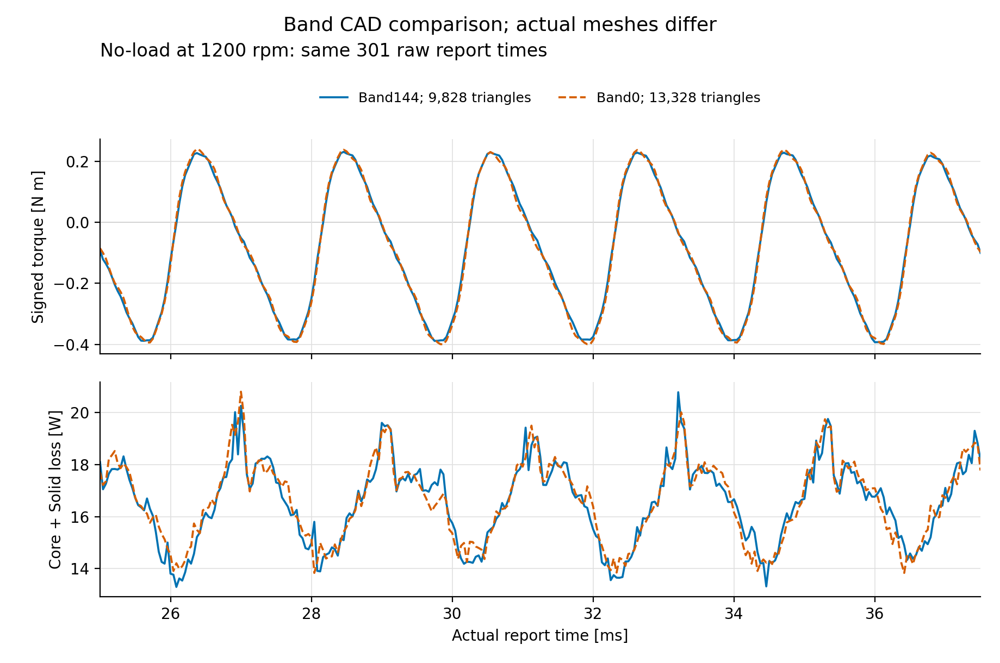

# Band CAD144/0: 닫힌 NoLoad 두 건의 실제 비교

같은 Source859/producer43067의 G1·I0·beta0·1200rpm·M19·P3S300·fullXY/Sym1·depth43.6181mm·M1·CoreLossEffectOnField=True 두 건이다. 요청 Spec 차이는 Band CAD segments144→0 하나다. CAD edge는144→1이며 실제 mesh는9828→13328 triangles로 **35.612536% 증가(약36%)**했다. 같은 mesh에서의 비교가 아니다.



[SVG](band_geometry_pair.svg) · [요약2행](comparison.csv) · [마지막 주기301행](last_cycle.csv) · [증거SHA·원차이](evidence.json)

|관측|164 Band144|166 Band0|
|---|---:|---:|
|실제 triangles|9828|13328|
|controller elapsed [s]|914.522|1219.883|
|solve [s]|733.027903|1038.883889|
|Tω [W]|-10.439623587643844|-10.575570615251474|
|Core+Solid [W]|16.549105968235914|16.610626112739428|
|기존 residual [W]|-6.10948238059207|-6.035055497487955|

관측된 solve 시간은 **+41.725013% (약41.725%)**, residual166−164는 **+0.074426883104115W**다. CAD144를 없앤166에서도 약−6.04W가 남으므로 CAD144만의 단독 원인 설명은 지지되지 않는다. 손실과 토크 및 mesh가 함께 변했고 반복 실행/mesh·time 수렴/MST 검증을 하지 않았으므로, 시간 증가의 원인이나 어느 결과가 더 정확한지는 단정하지 않는다.

그림은 두 원시 CSV의 공통 실제 Time[ms]301개(raw24.9999999999998–37.5ms; 의도한 마지막 주기25–37.5ms)를 그대로 쓴다. torque의 mNm→Nm 변환 한 번 외에 보간·위상 정렬·평활화·fit·깊이 재배수는 없다. Core+Solid는 같은 시점의 두 보고량 합이다. 표의 평균·전력·잔차는 기존 Source859 산출값을 유지했다. 이301개 보고 시점과51개 저장 field 시점은 서로 다른 자료다.

실제 cache는 각51 ASOL mapping/디렉터리51/fld510이다. ASOL 첫 raw time0.02499999999999985와 rational grid의 최대3.2e-16s 차이를 evidence에 그대로 보존했다. Native 반환 field time은 미관측이며 새 허용오차/remap은 없다. 효율 first/last/all NaN3개를0으로 바꾸지 않았고, Native0 대비 M19·NdFeB ModTime int2개 원차이도 남겼다.

두 건 모두 원래 Analyze exactTrue/정상 profile/actual4core×901/15s 소유 Native Quit→gone→client retired/errors[]와 saved35·52변수·BH23·권선24를 확인했다. full ModelSetup 전체 동등성, production/training admission, calibration/정확도/최적점은 승인하지 않았다. Source17 전류구동 실험과도 별도 producer다. 이 묶음 생성은 Native/FEA/API/예약/Y/원본 변경0이다.

재생성(포함된301행과 SHA를 확인하며 새 출력 폴더 사용):

```sh
python regenerate.py --output-dir regenerated
```

Python3와 matplotlib이 필요하다. 그림 byte는 matplotlib/font 버전에 따라 달라질 수 있으며 숫자 입력은 evidence의 SHA로 검증한다. 실제 해석을 다시 실행하지 않는다.
